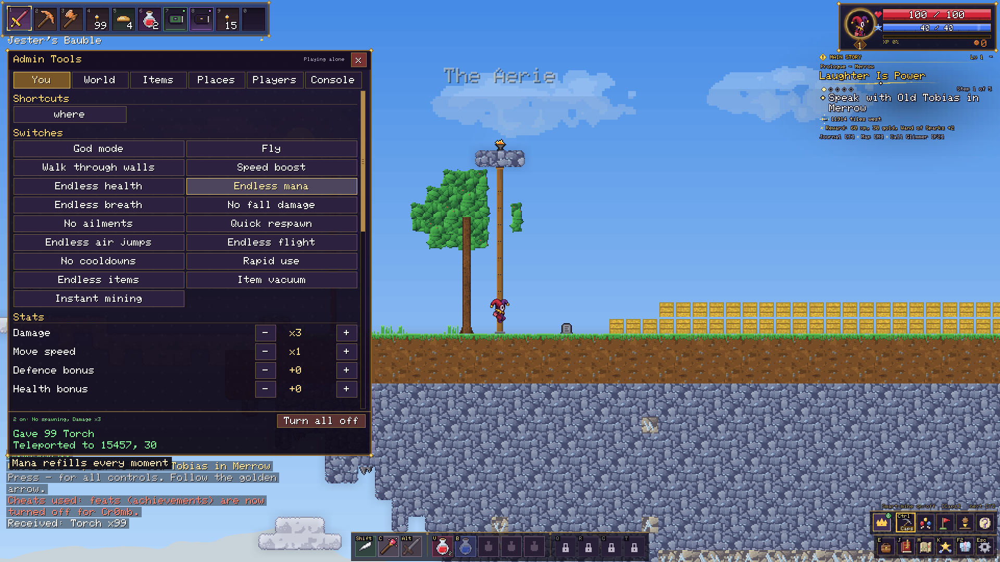
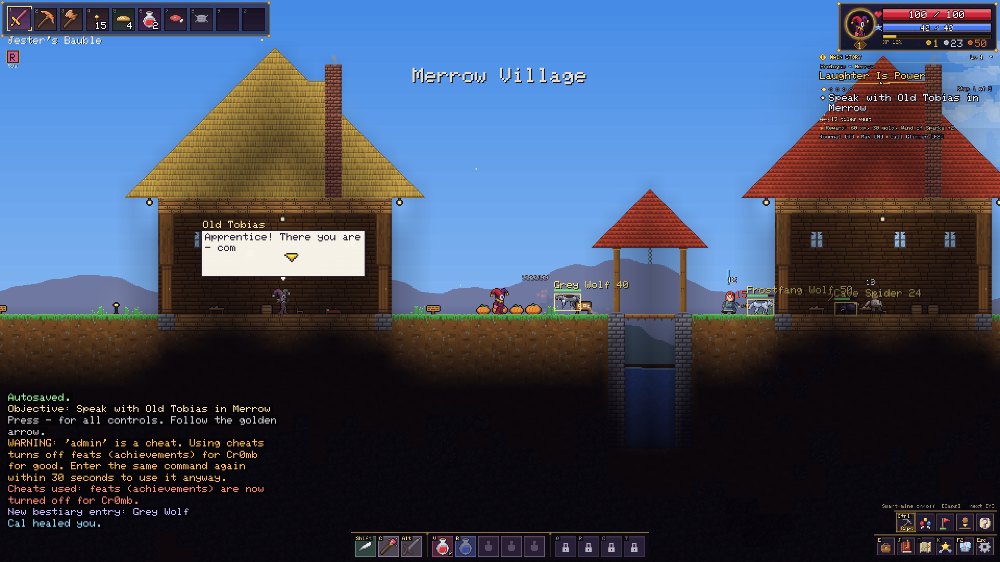
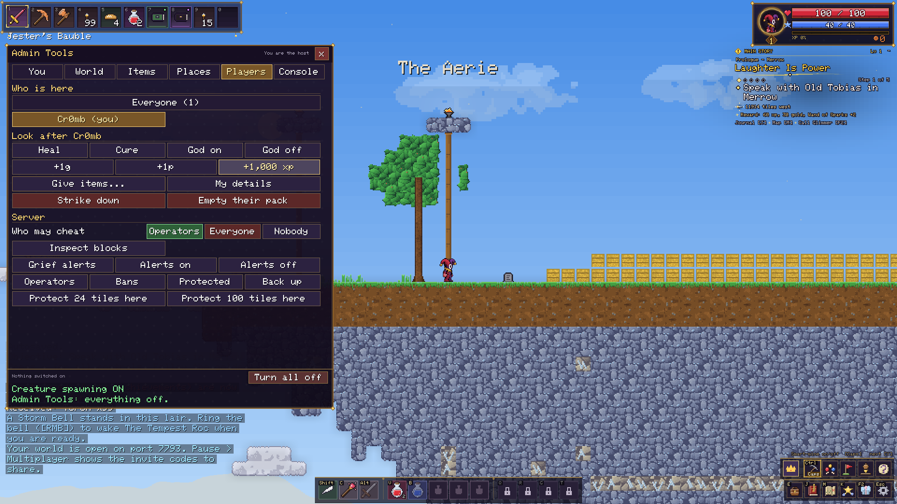
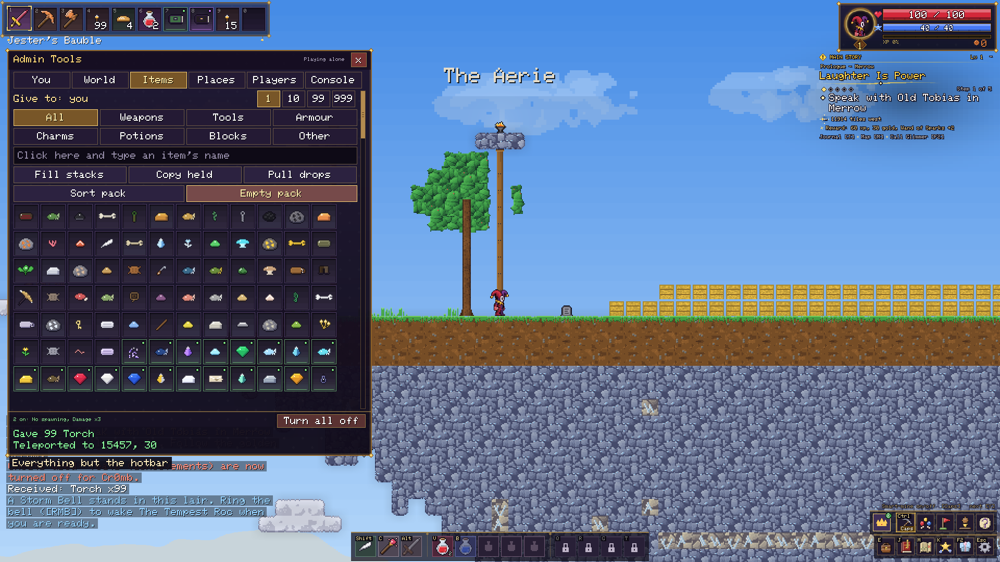

# Admin Tools

By **Cr0mb** · version 2.1 · for Jester 1.14.0 (works with Jester 1.14.0 and later for the panel. On 1.13.0 the console commands work without it; on 1.11.0 and 1.12.0 only the old)

A window for everything the console can do, so you never need to remember a command. The crown button beside the tools opens it. You: switches, stats, buffs. World: time, weather, creatures. Items: search and click to give. Places: click to go there. Players: heal, give, bring, mute, freeze, kick, ban and server settings, without typing a name. Console: every command listed and searchable. Right click any control to pin it to the top. In single player anyone can use it, and feats (achievements) turn off for that character. Online only the host and server operators can, and the server checks it.

*The panel: every switch and stat a click away, with the world still running*

*See through walls: creatures boxed with their health*

*Players: look after, move or remove anyone, and run the server, without typing*

*Items: search, choose how many, click to give, to yourself or another player*

## Download

- Latest: [admin-tools-2.1.zip](versions/2.1/admin-tools-2.1.zip) (3 files)
- SHA-256: `9c44b7b447369dbbb1f7a2968a6121d0deea478744c4bd72ad23ad0a73df864e`
- Easiest: open the **Jester Launcher**, go to Mods and add it from there, or see it on [jestercastles.com](https://jestercastles.com/mods.html#mod-1).

## Versions

| Version | Date | SHA-256 |
|---|---|---|
| [2.1](versions/2.1/admin-tools-2.1.zip) | 2026-11-11 | `9c44b7b447369dbb…` |

---
Shared by its author through [jestercastles.com](https://jestercastles.com/mods.html), checked file by file and reviewed by staff before it was listed. 
Jester mods are pictures, sounds and data tables only: the game never runs code from a mod. 
Something wrong with it? Use **Report** on its page on the site, or the [copyright page](https://jestercastles.com/copyright.html) for your own work.
